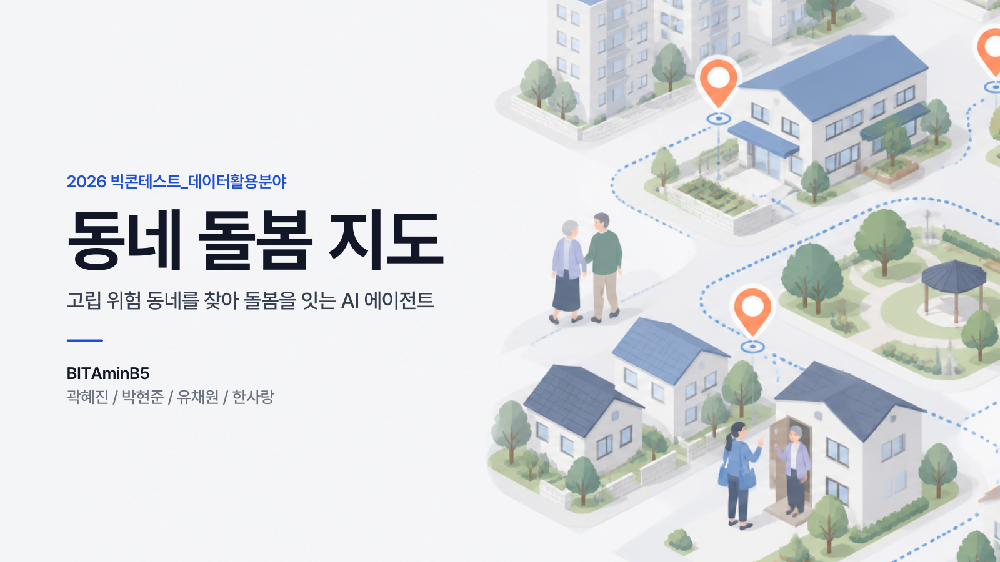

# 동네 돌봄 지도 · 제14회 빅콘테스트 (AI데이터활용)

> 통신 유동인구·인구·건물·복지시설 데이터로 고립 위험 동네(250m 격자)를 찾고, 방문 우선순위를 제안하는 AI 에이전트
> 4인 팀 (에이전트 / 백엔드 / 프론트엔드 / **본인: EDA·분석 엔진**) · 2026.09 ~ 10

**핵심 결과 (팀)**: 춘천 7,393칸 → 긴급방문 55칸, 강남 698칸 → 13칸으로 방문 범위 98~99% 압축. 6개월 내내 위축된 칸이 무작위 대비 7~10배
**원본**: [팀 레포](https://github.com/Jinx921/26-2_BITAminB5) · [배포](https://bigcontest-production.up.railway.app)

---

## 1. 문제

복지 현장은 인력이 한정돼 어디부터 찾아갈지 정해야 하지만, 고립된 사람은 스스로 도움을 요청하지 않습니다.
개인을 식별할 수 없는 집계 데이터로 **"누구"가 아니라 "어느 동네"**를 먼저 확인할지 좁혀 주는 것을 목표로 했습니다.

## 2. 데이터

| 데이터 | 출처 | 범위 |
|---|---|---|
| 통신 유동인구 | 대회 제공 (SK텔레콤) | 2025.07 ~ 12, 50m → 250m 격자 |
| 카드 소비 | 대회 제공 (신한카드) | 2025.07 ~ 12, 시군구 |
| 인구·가구·주택 | 국가데이터처 SGIS | 1km 격자 |
| 건물 | 국토교통부 GIS 건물통합정보 | 주거 용도·사용승인일 |
| 복지·생활 시설 | 강남구청, 춘천시보건소, 공공데이터포털 | 위치 좌표 |

- 대회 제공 데이터는 참가자 한정이라 저장소에 포함하지 않았습니다.

## 3. 접근

정답 데이터가 없어 지도학습 대신 **설명 가능한 규칙**으로 후보를 좁혔습니다.

| 단계 | 기준 | 강남 / 춘천 |
|---|---|---|
| 1. 전체 칸 | 통신 유동인구가 있는 250m 칸 | 698 / 7,393 |
| 2. 거주 칸 | 야간 체류 + 주택 수 + 주거 건물 | 526 / 1,615 |
| 3. 활동 위축 칸 | 비슷한 동네보다 낮 활동이 낮은 달이 6개월 중 4개월 이상 + 고령 비율 상위 25% | 51 / 153 |
| 4. 긴급방문형 | 위축 칸 중 경로당 500m 밖 또는 보건기관 3km 밖 | 13 / 55 |

- 활동 위축: 하루 활동 패턴으로 비슷한 동네를 묶고(KMeans), 같은 달 안에서 중앙값 기준(robust z)으로 비교
- AI 에이전트는 질문 해석과 설명만 맡고, 숫자는 모두 분석 엔진이 계산

## 4. 내 역할

위 흐름 중 다음을 맡았습니다.

- 인구·1인가구·건물 EDA, 거주 칸 판정 기준에 반영
- 위험 후보 탐색·4유형 분류 분석 엔진 구현
- 팀원 후보 로직 이식 검증 (257/257 일치)
- 성능 평가 설계: 무작위 1,000회 비교, 기준 민감도
- 도시별 위험 요인 분석

에이전트, 백엔드, 프론트엔드는 다른 팀원이 맡았습니다.

## 5. 결과

| 결과 | 강남 | 춘천 |
|---|---|---|
| 방문 범위 압축 | 698 → 13칸 (98.1%) | 7,393 → 55칸 (99.3%) |
| 6개월 내내 위축된 칸 (실제 / 무작위 평균) | 31 / 3 | 45 / 6 |
| 위축 칸의 특징 | 노후 건물 비율 100% (일반 거주 칸 52%) | 교류시설까지 375m (일반 거주 칸 257m) |

- 같은 위험 동네라도 강남은 생활자원 부족, 춘천은 시설 접근성이 원인이라 도시마다 대응을 다르게 제안했습니다.

## 6. 한계

- 정답 데이터가 없어 정확도 대신 우연 비교와 기준 민감도로만 검증했습니다.
- 후보는 확정이 아니라 현장 확인 대상이며, 기준값(특히 주택 수)에 따라 달라집니다.
- 통신 데이터는 체류 인구라 거주 여부는 주택·건물로 간접 판단했습니다.
- 2개 도시, 6개월 자료라 인과나 일반화는 주장하지 않습니다.

## 7. 참고

- 결과보고서: 「동네 돌봄 지도」 (39쪽)
